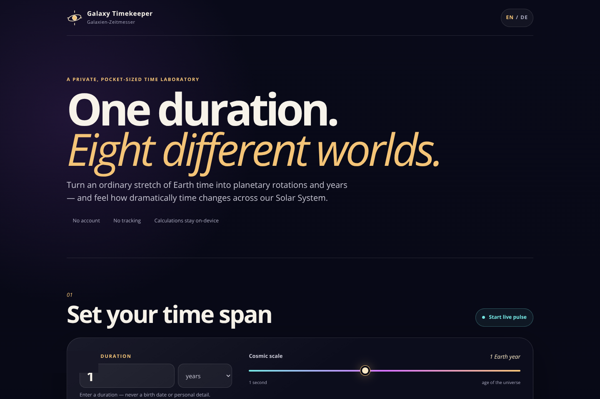

# Galaxy Timekeeper

**One duration. Eight worlds. Completely different time.**

Galaxy Timekeeper is a mobile-first, bilingual web experience that translates any Earth time span into axis rotations and planetary years across all eight planets. It is designed to turn abstract astronomical tables into something people can explore, compare, and feel.

Built with Codex and GPT-5.6 for **OpenAI Build Week 2026**.

> Live demo URL will be added after the GitHub Pages deployment.

## Preview



[Explore the planet focus](docs/media/devpost-explorer.png) · [Compare all eight worlds](docs/media/devpost-results.png)

## The problem

Planetary time is usually presented as a list of numbers: Mars has a 24.6-hour rotation, Neptune takes about 165 Earth years to orbit the Sun, and so on. Those facts are accurate, but static tables make it difficult to build an intuitive sense of scale.

Galaxy Timekeeper gives one familiar Earth duration many simultaneous meanings. A coffee break, one year, a century, or even the age of the universe becomes a visual journey through eight very different rhythms.

## What it does

- Converts seconds, minutes, hours, days, or years into planetary time
- Compares all eight planets at once
- Shows both **axis rotations** and **completed orbits (planet years)**
- Offers a logarithmic slider from one second to 13.8 billion Earth years
- Includes quick journeys such as a coffee break, an Earth year, and the age of Earth
- Provides a focused, animated view for every planet
- Includes a live pulse that translates passing seconds in real time
- Explains the scientific distinction between rotation and orbit
- Works in English and German
- Respects reduced-motion preferences and keyboard navigation
- Uses no account, database, analytics, cookies, or stored personal data

## Privacy by design

The original concept considered using a person's birth date. We deliberately removed that idea.

Galaxy Timekeeper accepts only a **duration**, never a name, birth date, email address, location, or profile. All calculations happen locally in the browser. Nothing is stored, transmitted, or tracked.

## Run it locally

No build step and no dependencies are required.

```bash
git clone <repository-url>
cd galaxy-timekeeper
npm run serve
```

Open [http://localhost:4173](http://localhost:4173).

Any static web server can host the project. GitHub Pages is the intended demo platform.

## Test it

The calculation layer is separated from the interface and covered by Node's built-in test runner.

```bash
npm test
npm run check
```

The current suite verifies unit conversion, boundary handling, planetary rotations and orbits, logarithmic scale round-trips, readable units, and result extremes.

## How the calculations work

Every input is normalized to Earth seconds.

```text
axis rotations = duration in seconds / rotation period in seconds
planet years   = duration in seconds / orbital period in seconds
```

The app uses a sidereal-style axis rotation concept: one complete spin relative to distant stars. Retrograde rotation changes direction, not the positive elapsed duration displayed by the app.

The figures are rounded educational values and are not intended for spacecraft navigation or mission planning.

## Architecture

```text
index.html          semantic interface and content structure
styles.css          responsive visual system and CSS planets
js/data.js          local planet facts and NASA source links
js/calculations.js  pure conversion and formatting functions
js/app.js           state, interactions, rendering, and i18n
tests/              calculation tests
```

The project is intentionally dependency-free at runtime. Planet artwork is made entirely with CSS gradients, which avoids third-party image requests and licensing uncertainty.

## How we collaborated with Codex and GPT-5.6

This project began during the OpenAI Build Week submission window and was developed in one core Codex project thread.

### Human product and design decisions

- Defined the original “Galaxien-Zeitmesser” concept: interactive planetary years, rotations, sliders, and automatic calculations
- Chose a mobile website with no login, database, or personal data
- Set an internal deadline six hours before the official submission cutoff
- Selected a tone that balances scientific clarity with playful cosmic wonder
- Prioritized a complete, understandable product over a larger unfinished feature set

### Where Codex accelerated the work

- Checked the current Build Week rules, required deliverables, deadline, and judging criteria
- Turned the early concept into a focused, testable MVP
- Verified the astronomical method against NASA planet facts
- Designed and implemented the responsive interface, CSS planet system, bilingual copy, live mode, and calculation engine
- Separated pure calculations from DOM behavior so the mathematical core could be tested independently
- Created automated tests and performed real browser checks at 390 px and 1440 px widths
- Found and corrected a mobile grid overflow during visual QA
- Drafted the repository documentation and submission plan

### Key decisions made together

1. **Duration, not date of birth.** This preserves the emotional idea while removing personal data entirely.
2. **Rotations, not an ambiguous “day.”** Solar days and sidereal rotations differ dramatically on planets such as Mercury and Venus. The interface names the measured quantity explicitly.
3. **Static-first architecture.** A browser-only app is faster to test, easier for judges to run, and has no server-side privacy surface.
4. **English plus German.** English supports judging; German preserves the project's original voice and makes it useful to its first audience.
5. **A logarithmic time lens.** One control can meaningfully span seconds, human lifetimes, planetary formation, and cosmic history.

## NASA data sources

- [Mercury facts](https://science.nasa.gov/mercury/facts/)
- [Venus facts](https://science.nasa.gov/venus/venus-facts/)
- [Earth facts](https://science.nasa.gov/earth/facts/)
- [Mars facts](https://science.nasa.gov/mars/facts/)
- [Jupiter facts](https://science.nasa.gov/jupiter/jupiter-facts/)
- [Saturn facts](https://science.nasa.gov/saturn/facts/)
- [Uranus facts](https://science.nasa.gov/uranus/facts/)
- [Neptune facts](https://science.nasa.gov/neptune/neptune-facts/)

## Build Week submission fit

- **Recommended track:** Apps for Your Life
- **Working project:** Browser-based and deployable on any static host
- **Testing access:** No account or credentials required
- **Repository:** Public with an MIT license
- **Demo video:** Under three minutes, public on YouTube, with audio explaining both the product and the Codex/GPT-5.6 collaboration
- **Codex evidence:** The `/feedback` Session ID from the core build thread will be added to the Devpost form

## License

[MIT](LICENSE) © 2026 Zinaida Mauersberger
